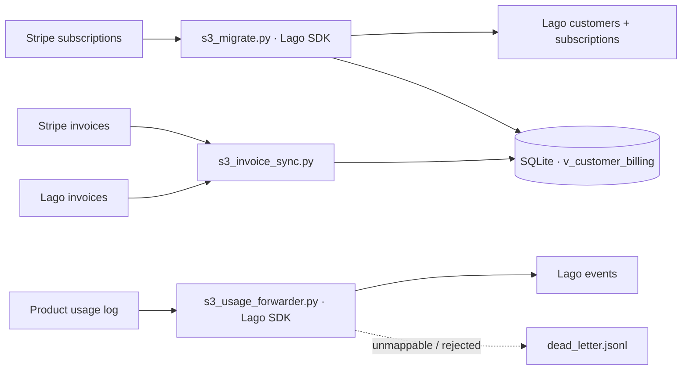

# Lago: Solutions Engineer case study (Daniel)

> Code and reproducible setup: **https://github.com/danielctin14/lago-case-study**. Technical experiments were run against a self-hosted Lago v1.57.0 (PostgreSQL event store) and Stripe test mode; proposed production designs are marked as untested. Evidence tags: ✅ tested · 📘 documented · ⚠️ to confirm.

## Results at a glance

| Section | Outcome | Tested ✅ | Still unverified ⚠️ |
|---|---|---|---|
| **1. Acme AI follow-up** | Debrief (deal health, stakeholders, owners and deadlines) and a short email asking for two dated sessions; finance and Kafka appendices | Product claims checked against Lago docs | Which tier includes Kafka ingestion |
| **2. SaaSCo duplicate charges** | Root cause: a merge-and-PUT plan sync duplicates every SKU. Diagnostic, reviewed fix, customer message | 3 scenarios reproduced; $260 billed instead of $130; diagnostic exit 1 → 0 after fix | curl/jq variant not executed |
| **3. Stripe → Lago migration** | Stripe ids reused as Lago ids; idempotent migration (Lago SDK); replay-safe usage; both invoice sets in SQLite | 100/100 migrated, re-run creates 0; replay 0 new / 900 skipped; 108 invoices; reconciliation caught cutover double-billing | 10,000-scale run; period-end cutover; ClickHouse deduplication |
| **4. Gateway pricing** | Base: config + custom. VPN allowance: custom. Trial: partly native. A Lago-managed job proposed, subject to approval | Prorated tiers; trial waives the base fee only; pooled vs per-gateway allowance ($10 vs $50); Premium 403s | Draft-hold of advance-billed charges; free-plan trial; pre-start events |
| **Bonus: Vortex AI** | One-page 90-day plan, three phases with measurable exit criteria | n/a (strategy) | n/a |


---

# Section 1A: Acme AI demo debrief (internal)

**To:** [AE], #deal-acme-ai · **From:** Daniel (SE) · sent ~1h after the call

> **Bottom line**
> The VP Eng is engaged, but technical validation and finance buy-in remain open, and we left without a next step.
> The deal moves only if we win the **Staff Engineer** (Kafka) and the **Head of Finance** (rev-rec) in the next 10 days, so the follow-up has to earn **two dated sessions**.

*Assumption (the brief doesn't say): the demo walked through usage events → billable metrics → a committed-spend plan with overage → the invoice.*

## Stakeholders and deal health

| Role | Status | My read | Needs, to say yes |
|---|---|---|---|
| **VP Engineering** (sponsor, champion candidate) | 🟢 fit · 🟠 untested champion | Mapped Lago onto their stack himself | A low-risk plan he can present internally without us |
| **Head of Finance** (approver, likely veto) | 🟠 | Joined for 15 min with two precise questions; my rev-rec answer wasn't crisp | A worked example with numbers, and proof her close doesn't get harder |
| **Staff Engineer** (implementer, quiet veto) | 🟠 | Silent until the last minute; his question is really about effort | A concrete integration pattern and an effort estimate |
| **Momentum** | 🔴 | "We'll be in touch." No date, no owner | Two dated sessions |

## The open questions, answered properly

**Kafka.** **Yes, no custom connector.** 📘 Lago either consumes from **their** topic or they publish to a **Lago-hosted** one (VPC peering or PrivateLink), on Lago's ClickHouse event store, which Lago Cloud manages. The main change on their side is mapping messages to Lago's event fields; we also validate network access, credentials and throughput together. REST batch takes the same schema, so a pilot can start there. ⚠️ Confirm which tier includes streaming ingestion **before** the email goes out.

**Rev-rec.** What I *should* have said:
> "Lago produces your billing numbers: what was invoiced, for which service period, and how much commitment was consumed. Your ERP stays the ledger. Prepaid commitment is deferred and recognized as it's consumed; overage as it's used; unused commitment or a true-up is its own line, so your policy applies cleanly."

📘 Building blocks: wallets, minimum commitments, progressive billing. The rev-rec module is in private beta, worth showing, but her close shouldn't depend on it. Details are in Appendix A.

**Timeline.** The call answer was fine. Appendix A restates it as phases; the one-cycle parallel run sets the pace.

## What I'd do differently
- **Bring late joiners up to speed.** A 60-second recap when Finance joined would have stopped me answering a finance question in billing vocabulary.
- **Never leave on "we'll be in touch."** I set up the next meeting myself and confirm the slot on the call.
- **Every open topic gets an owner and a hard deadline.** "Kafka answer by tomorrow 10:00," not "I'll follow up."
- **Draw quiet people in early.** "How would this sit next to your pipeline?" in minute 10, not minute 59.

## Actions and risks

| # | Action | Owner | Deadline |
|---|---|---|---|
| 1 | Confirm the streaming-ingestion tier and the ClickHouse requirement | Daniel + Lago product | **Today 18:00** |
| 2 | Send the follow-up email with Appendices A and B | Daniel | **Tomorrow 10:00** |
| 3 | Call the VP Eng to lock the sessions (a call converts better than email) | **AE** | **48h** |
| 4 | Line up a Lago finance specialist and a Lago engineer for the sessions | Daniel | **Fri** |
| 5 | Sandbox with their pricing, plus the event mapping from their sample message | Daniel | **Before session** |
| 6 | No slot by Friday: AE nudges the VP; I send the Kafka note to the Staff Engineer directly | AE + Daniel | **Mon** |

**Risks:** the decision happens in the "team sync" without us (→ a forwardable package); a late Finance veto (→ a finance session now); "we'll build it ourselves" (→ map their sample message and size the effort together); a packaging surprise (→ confirm tiers before anything commercial). **Ask to the AE:** own decision process, paper process and competition in your call with the VP.


---

# Section 1B: Follow-up email (sent within 24 hours)

**To:** VP of Engineering · **Cc:** Head of Finance, Staff Engineer, [AE]
**Subject:** Acme AI × Lago: your two open questions + next step
**Attachments:** Appendix A (committed spend + overage), Appendix B (Kafka integration note)

---

Hi [First name],

Thanks for yesterday, and for the sharp questions from the whole team. I owed you answers on two points, so here they are.

**For [Head of Finance]: committed spend + overage.** Lago produces the billing numbers; your ERP stays the ledger. Prepaid commitment is invoiced upfront, deferred, and recognized as usage consumes it. Overage is billed and recognized as it's used. Unused commitment or a true-up is its own invoice line, so your policy applies cleanly. Appendix A walks through a 3-month example and the implementation timeline.

**For [Staff Engineer]: Kafka.** Yes, no custom connector. Lago can read from your existing topic, or you publish to one we host. The main change on your side is mapping each message to the fields Lago bills on (Appendix B), and together we'll validate network access, credentials and throughput. If you send me one sample message **by Monday**, I'll bring it already mapped.

**Next step: two short sessions next week**

| Session | Who | What we'd cover |
|---|---|---|
| **45 min, technical** | Staff Engineer + data/infra; one of our engineers | Kafka pattern, your sample mapped, effort estimate |
| **30 min, finance** | Head of Finance; our finance specialist | The worked example against your contract shape |

Could you reply **by Friday** with one slot for each? Technical: **Tue 24 or Wed 25 Nov**. Finance: **Wed 25 or Thu 26 Nov** ([Head of Finance], feel free to answer directly). I'll send invites and a one-line agenda the same day.

Best,
Daniel
Solutions Engineer, Lago


---

# Appendix A: Committed spend + overage, how the money flows

*For Acme AI's Head of Finance. The treatment is **illustrative**, to show which numbers Lago produces. It isn't accounting advice; your policy and auditors decide.*

**Example:** a **$30,000** commitment over 3 months. Usage at list price: $8,000, $12,000, $14,000 = **$34,000**, so the commitment is used up in month 3 with **$4,000 of overage**.

**Shape A: prepaid commitment (invoiced upfront, drawn down by usage)**

| | Invoiced | Recognized | Deferred | Lago source |
|---|---:|---:|---:|---|
| Day 1 | **$30,000** | – | $30,000 | Prepaid-credits top-up invoice |
| Month 1 | $0 | $8,000 | $22,000 | Usage invoice, credits applied −$8,000 |
| Month 2 | $0 | $12,000 | $10,000 | Credits applied −$12,000 |
| Month 3 | **$4,000** | $14,000 | $0 | Credits −$10,000; overage invoiced $4,000 |

If usage stays below $30,000, the unused balance is what's left when the credits expire. Lago gives the exact amount and date; your policy decides the "breakage" treatment.

**Shape B: postpaid minimum commitment (quarterly plan).** In Lago, a minimum commitment is evaluated over the plan's billing period, so a 3-month commitment means a **quarterly** plan. The $8k / $12k / $14k accrue as live usage (recognized monthly as delivered), and **one $34,000 invoice** is issued at quarter end. Usage beat the minimum, so there's no true-up. At $25,000 of usage, that invoice would carry a separate **$5,000 true-up** line. Progressive billing (Premium) can invoice during the quarter if needed.

**Implementation timeline:** design (contract → Lago configuration) → integrate (events into a sandbox) → **parallel run of one full billing cycle**, compared line by line with your current invoicing → go-live. The parallel run sets the pace, deliberately: nobody should switch billing systems on trust.

**What Lago does and doesn't do:** it meters and prices usage, tracks prepaid credits, bills commitments, overage and true-ups as distinct lines, and syncs to accounting systems (e.g. NetSuite, Xero). It does **not** replace your ledger or decide your recognition policy. The revenue recognition module (ASC 606 / IFRS 15) is in **private beta**: we're happy to show it, but its output should be reconciled against your ERP before any statutory close relies on it.


---

# Appendix B: Kafka ingestion, integration note

*For Acme AI's Staff Engineer.*

**No custom connector.** Lago consumes Kafka directly, in one of two ways: **(A)** Lago reads your existing topic (you grant broker/topic access), or **(B)** you produce to a topic Lago hosts for you (VPC peering or PrivateLink). Both run on Lago's ClickHouse event store, which Lago Cloud manages.

**The message shape Lago bills on:** `transaction_id` (unique; used for deduplication, so retries never double-bill), `external_subscription_id`, `code` (the metric, e.g. `llm_tokens`), `timestamp`, and `properties` (e.g. `{"tokens": 1250, "model": "large", "direction": "output"}`). If your messages carry these, there's nothing to build. If not, it's a small mapping step, not a connector. Together we'll also validate network access, credentials and throughput. The REST batch API takes the same schema, so you can pilot over REST and move to Kafka later.

**By Monday, to prepare the session:** one sample message (anonymized), your preference between A and B with any network constraints, and a rough volume (peak events/second, monthly total).


---

# Section 2: SaaSCo duplicated charges (Tokens, Storage, GB-S, Seats)

> **Bottom line**
> Reproduced on Lago v1.57.0. A plan "sync" job that reads the plan, **appends** the charges from its config (which carry no Lago ids) and writes it back puts every SKU on the plan twice, so every subscription is billed **2×**. Lago accepts this silently, because several charges on one metric is a legitimate feature. Nothing broke in Lago; the automation changed, which fits "it worked, then broke a few days later."
> Fixing the **configuration** is quick once reviewed. **Reconciling affected invoices** takes longer.

## 1. Replicating the setup

One monthly plan with four usage charges: Tokens (sum), Storage (max GB), GB-S (sum), Seats (unique count of `seat_id`, **recurring**). ✅ Seats isn't a fixed charge because per-subscription fixed-charge units return `403 feature_unavailable` on self-hosted open source.

[s2_repro.py](https://github.com/danielctin14/lago-case-study/blob/main/src/lago_case/s2_repro.py) reproduces it three ways: the realistic **sync-append** job (GET plan → append charges without `id` → PUT), a **direct** `POST /plans` with every metric twice (✅ accepted, no warning), and a **duplicate subscription** (fresh `external_id` per run: same symptom, different cause).

```text
Day 0: plan: 4 charges ['gb_seconds', 'seats', 'storage_gb', 'tokens']
Day N: 'price sync' job runs (GET plan -> append desired charges without ids -> PUT)
       plan: 8 charges ['gb_seconds', 'gb_seconds', 'seats', 'seats', ... 'tokens', 'tokens']
       current usage for sub_saasco_demo_001: total $260.00     <- should be $130.00
```

✅ How `PUT /plans` treats charges (undocumented, so probed): a full list **without** ids replaces them (safe). Existing charges **with** ids plus new ones **without** ids keeps both (**duplicates**). Omitting `charges` leaves them alone. `charges: []` **wipes every charge**.

## 2. Confirming it, and the action plan

**Symptom first:** all four SKUs appear as *separate* lines at once, which points at the plan or the subscriptions. Duplicate events would inflate the quantity on one line, not add a line.

| Hypothesis | Signature in Lago |
|---|---|
| **H1** Non-idempotent plan sync (merge-and-PUT, or retry after a timeout) | Same metric twice; the duplicates' `created_at` = the day it broke |
| **H2** Duplicate subscriptions | 2+ active subscriptions on one plan for one customer |
| **H3** Duplicate events (`transaction_id` regenerated) | Doubled quantity on a single line |
| **H4/H5** Webhook handler running twice; plan overrides | Their logs; `lago_parent_id` on charges |

1. **Contain (first hour):** pause the automation; check which invoices are finalized and when the next billing run is.
2. **Confirm:** run the diagnostic with them; match the duplicates' `created_at` to their deploy logs. Activity logs aren't available on open source (✅ 403).
3. **Review, then fix (same day):** several charges on one metric **can be intentional** (filters, per-model prices). Review filters, overrides, the subscriptions on the plan and the invoice impact with the customer; remove only confirmed duplicates, keeping the originals (`--fix` dry-run → sign-off → `--fix --apply`). ✅ Ingested usage is preserved.
4. **Remediate:** refresh draft invoices; credit notes (or void) for finalized ones; quantify per customer.
5. **Prevent (this week):** build the *full* desired charge list with Lago ids and never merge; keep ids stable; refuse to PUT if a metric appears twice without filters or the list is empty; run the diagnostic before each billing run.

## 3. Troubleshooting script

[s2_diagnose.py](https://github.com/danielctin14/lago-case-study/blob/main/src/lago_case/s2_diagnose.py) is read-only by default and exits 1 on any finding, so it can run as a guardrail. Six checks: duplicate charges and when they appeared, duplicate subscriptions, dollar impact, affected invoices (draft vs finalized), duplicated events, audit-trail availability. A curl + jq version for the customer's engineer is in [scripts/s2_diagnose_curl.sh](https://github.com/danielctin14/lago-case-study/blob/main/scripts/s2_diagnose_curl.sh) (⚠️ not executed locally).

```text
[1] Plan 'saasco_standard_s2': 8 charges
    DUPLICATE tokens: original created 20:41:52Z, duplicate created 20:41:53Z   <-- when it broke
[3] sub_saasco_demo_001: billed so far $260.00, expected $130.00, excess $130.00
FINDINGS: duplicate charges for 4 SKUs; over-billed $130.00            exit code 1
$ ... --fix --apply   then re-run:
[1] Plan 'saasco_standard_s2': 4 charges · excess $0.00 · CLEAN          exit code 0
```

## 4. Closing the loop

> **Subject:** Duplicated charges: root cause, fix and next steps
>
> Hi [Name], first, I'm sorry. Double invoices land on your customers and your finance team, and I know this cost you time and some awkward conversations. Thank you for flagging it quickly; your logs made the root cause easy to pin down.
>
> **What happened:** on [date], the new price-sync job started adding the four charges from your config to the plan without Lago's charge IDs, so Lago created them as new charges. Every SKU was billed twice from that day on.
> **Impact:** [N] customers, [N] invoices, **$[X]** (list attached).
> **What we've done:** removed the duplicates, keeping your original charges and all usage, and [refreshed drafts / issued credit notes].
> **What we need by [date]:** update the job to send existing charge IDs (or the full list without merging); keep it paused until then.
> **So it doesn't come back:** the attached check fails if any plan has a SKU twice; run it before each billing run. I'll check your next billing run on **[date]** myself. Happy to help draft the note to your own customers.
>
> Daniel

**Internally:** a help-center article on updating plan charges safely; product feedback (warn on a metric attached twice without filters, a dry-run mode for `PUT /plans`, a confirmation before `charges: []`); an offer to review their other automations.


---

# Section 3: Stripe → Lago migration (customers, subscriptions, usage, invoices)

> **Bottom line**
> **Verified** against Stripe test mode and self-hosted Lago v1.57.0 (PostgreSQL event store): **100 of 100** subscriptions migrated with 0 failures, re-runs are no-ops, the usage flow is replay-safe, and invoices from both systems sit in one SQLite database with a reconciliation view.
> **Proposed, not yet proven:** the 10,000-subscription rollout and the period-end cutover; both need a load test and a pilot cohort.
> Key design choice: **Stripe ids become Lago external ids**, so there's no mapping table and the usage stream switches destination without a lookup.



## 1. Customers and subscriptions ([s3_migrate.py](https://github.com/danielctin14/lago-case-study/blob/main/src/lago_case/s3_migrate.py))

| Stripe | Lago |
|---|---|
| `customer.id`, name, email, currency | `customer.external_id`, name, email, currency (Lago upserts by `external_id`) |
| `subscription.id` | `subscription.external_id` on plan `saasco_standard` |
| Seats `quantity` | N `seats` add-events on a recurring metric, with deterministic `transaction_id`s so a retry never adds a seat |
| `current_period_end` | `subscription_at` + anniversary billing (customers keep their billing date) |

```text
$ uv run python -m lago_case.s3_migrate --start now
Migrated 100, failed 0 in 22.2s (4.5 subscriptions/s)
Reconciliation: Stripe 100 | Lago 100 | missing 0
$ (re-run)  Already migrated (checkpoint): 100. To migrate now: 0
```

**Safeguards designed for 10,000 (scale untested):** a SQLite checkpoint per subscription plus a Lago existence check (resumable after a crash), bounded concurrency with retries on 429/5xx, `--dry-run`, and a reconciliation report at the end of every run. A linear extrapolation gives ~37 minutes for 10,000, but that's an **estimate**: rate limits, data variety and recovery can behave differently at scale. Plan: load test on synthetic Stripe-shaped data → pilot cohort (~500) → batches with a reconciliation report after each.

## 2. The usage flow ([s3_usage_forwarder.py](https://github.com/danielctin14/lago-case-study/blob/main/src/lago_case/s3_usage_forwarder.py))

`stripe.billing.MeterEvent.create(...)` is replaced by `lago.events.batch_create(...)` through the Lago Python SDK.

```text
Forwarded 900 new events, skipped 0 already ingested, in 2.1s; dead-lettered 1 (gpu_hours: no Lago metric)
(replay)  Forwarded 0 new events, skipped 900 already ingested, in 1.9s   -> usage unchanged
```

- **Replay-safe:** the product's record id becomes `transaction_id`. ✅ On the PostgreSQL event store, a duplicate gets a per-record `422 value_already_exist`, which the forwarder counts as "already ingested." ⚠️ The ClickHouse store (used for Kafka) deduplicates differently, so re-verify, and keep timestamps stable across retries.
- **Atomic batches, no data loss:** ✅ one invalid event rejects the whole batch, so the forwarder reads the per-record errors, dead-letters the invalid records with Lago's reason, and resends the valid ones.
- **Accepted ≠ billed:** a success response means Lago stored the event, not that it will bill it. ✅ Events stamped before a subscription starts are stored but not billed; 📘 so are events for unknown subscriptions or metric codes. Mappings are validated before sending; production should also reconcile units sent against `current_usage`.

## 3. Invoices from both systems ([s3_invoice_sync.py](https://github.com/danielctin14/lago-case-study/blob/main/src/lago_case/s3_invoice_sync.py), [db.py](https://github.com/danielctin14/lago-case-study/blob/main/src/lago_case/db.py))

✅ 100 Stripe and 8 Lago invoices are stored in `invoices` and `invoice_lines` (SKU, quantity, amount, service period; all Lago lines carry one), upserted on `(source, id)`, so re-syncing never duplicates rows. `v_customer_billing` compares both systems per customer through the shared id.

> **What the reconciliation view caught:** for one customer, Stripe had already invoiced 20 seats **in advance** for 18 Nov–18 Dec ($400), and Lago billed them again, because the demo started Lago "now." That's exactly the double-billing a real cutover must avoid.

## 4. Cutover for the real 10,000 (proposed design, to validate with a pilot)
1. **Rolling, per subscription, at each Stripe period end:** `subscription_at` = Stripe `current_period_end`, so no period is billed twice.
2. **Two-phase:** set Stripe `cancel_at_period_end` only after the Lago subscription is verified.
3. **Send usage to both systems during the overlap;** Lago counts only events inside its own period.
4. **Parallel-run check:** compare per-customer totals in `v_customer_billing` for one cycle before switching Stripe off.

**Next to harden:** a real 10,000 run (p95 latency, error budget), syncing seat changes during the overlap, and a Lago webhook receiver for real-time invoice updates. Taxes, coupons and multi-currency customers are out of scope for this single-plan company.


---

# Section 4: Usage-based pricing for a connected-gateway vendor

> **Bottom line**
> Most of this is native Lago: a yearly calendar plan paid in advance, graduated tiers, a live gateway count from commissioning/decommissioning events, monthly VPN billing on a yearly plan, current and projected usage for their portal, and invoices handed to the ERP instead of emailed.
> **Not native:** amounts that depend on a **point-in-time snapshot of another metric** (N on 1 January; gateways active on the 1st of each month), and a trial that also covers **charges**.
> Both close with **one small scheduled job** (yearly + monthly) on Premium. Given their "no custom logic on our side" constraint, I'd propose a **Lago-managed implementation, subject to Solutions/product approval**. That's custom work, not configuration.

| # | Question | Verdict | Custom part |
|---|---|---|---|
| 1 | **Gateway base**, per customer, refreshed at renewal | **Configuration + custom** | A yearly job sets N at the 1 January cut-off |
| 2 | **VPN allowance** = gateways on the 1st × GB/gateway | **Custom** | The same job, monthly |
| 3 | **90-day trial** for base and VPN, prorated first invoice | **Partly native** | Start the subscription at trial end; the job prorates the first-year base |

**Native configuration (evidence):**
- **Gateway fleet:** unique count of `gateway_id`, **recurring**, with decommissioning as `operation_type: remove`. ✅ count · 📘 remove
- **VPN:** sum of `gb`, one event per session at session end, so it counts in the month it ends. ✅
- **Plan:** yearly, calendar billing, paid in advance, with `bill_charges_monthly`. ✅ accepted on open source
- **Pricing:** graduated tiers 1 / 2–10 / … / 500+ ✅, and gateways added during the year prorated in arrears. ✅ 12 gateways for 13 of 30 days billed exactly 13/30.
- **Portal and ERP:** current and projected usage for the portal; invoices finalized but not emailed (off by default). 📘

## 1. Gateway base: configuration + custom

Native: graduated tiers, calendar yearly billing in advance, a live count. If amounts differ only because **N** differs, one plan serves every customer.

Not native: "take a snapshot of the count on 1 January, bill it in advance, bill only gateways above it in arrears, never credit below it." A Lago charge bills either the live count or a fixed quantity someone has to set.

**Design:** the **base** is a graduated, in-advance fixed charge with `units = N`. **Additions** are a prorated, in-arrears charge on the gateway count with the first N free. **No credit below N** comes for free, because the base units don't change during the year. ✅ Setting units or overrides per subscription is Premium (`403` on open source).

**The renewal job runs at the contractual cut-off**, not before it:
1. It waits an agreed window for late events stamped before the cut-off.
2. It **reconstructs** N by replaying each subscription's timestamped commissioning/decommissioning events up to the cut-off. It never reads `current_usage`, which describes the open period, not a point in time: a gateway added at 00:15 on 1 January would inflate N.
3. It sets the units and the threshold.
4. Only then is the renewal invoice finalized.

**Safeguards:** a stated timezone for the cut-off; retry-safe "set, never increment" updates; alerts if any subscription is unconfirmed or N jumps beyond a sanity threshold; invoices held in draft until confirmed. ⚠️ Whether a grace period can hold an *advance-billed* fixed charge still needs testing; it's the riskiest assumption here.

## 2. VPN allowance: custom

Native: monthly evaluation, sessions counted in the month they end, per-GB pricing above a free allowance. Not native: an allowance that depends on another metric. Free units are static per charge ✅, and 📘 SQL expressions can't reference another metric.

**Configuration-only alternative, only if they change the offer:** group the VPN charge by `gateway_id` with a per-gateway free allowance. ✅ Tested at 10 GB per gateway with usage of 15 / 15 / 2 GB: the pooled spec bills **$10** (2 GB over 30), while per-gateway bills **$50** (5 + 5 + 0), because a quiet gateway's allowance can't cover a busy one. That's a different promise, so it's their call.

**Recommended:** the same job at each month's cut-off, with the same replay and safeguards, setting the free units per subscription to `count × GB per gateway` (Premium). Unused allowance is lost because the next run overwrites it.

## 3. Trial: partly native

✅ `trial_period: 90` waived a $1,200 in-advance base fee (no invoice at start). But the trial **doesn't cover charges**: ✅ the gateway charge accrued $463.67 during the trial (📘 the same for fixed charges). And 📘 graduated in-advance fixed charges can't be prorated.

**Recommended:**
1. Start the Lago subscription at **trial end** (`subscription_at` = registration + 90 days), on calendar billing.
2. The yearly job applies a one-off credit to prorate the first-year base.
3. ⚠️ To evaluate: Lago's free-plan → paid-plan transition, as an alternative to the delayed start.
4. ⚠️ Events stamped before a subscription starts aren't billed (✅), so the gateway state at trial end must be re-established. That needs a proper test.

## What I'd tell the customer

> "Most of your model is standard Lago configuration: the yearly calendar plan, graduated tiers, proration for added gateways, monthly VPN billing, and live usage for your portal, with invoices flowing to your ERP. Two parts need logic Lago doesn't have natively: N taken as a snapshot on 1 January, and a VPN allowance that follows the gateways active on the 1st. The trial also needs an adjustment, because Lago's trial waives only the base fee. I'd propose a small scheduled job that **we** build and operate, so you still only send raw events. It isn't a standard product feature, so I'll confirm with our Solutions and product teams that we can commit to it, and the effort, before we agree dates. It needs our Premium plan."

**Product feedback:** "units from a point-in-time metric snapshot" and "free units derived from another metric" would make this case native, and both are reusable for any fleet- or seat-based customer.


---

# Bonus: Vortex AI, 90-day renewal and expansion plan

> **Bottom line**
> Vortex's problem is **trust, not missing features**: the CFO calls Lago a burden, the VP Eng wants reliability, and nobody at Lago can explain how the account works today. We earn the renewal by making month-end close boring again, and pitch expansion only once there's measured proof. Each phase ends on measurable exit criteria; owners are in brackets.

**Days 1–30: restore trust, establish facts**
- Lago's CEO replies to the CFO in week 1, naming one accountable owner and this plan [CEO, drafted by SE + AE].
- Joint incident review: a root cause for every recent incident, not just a patch [SE + Lago engineering].
- Map the ERP reconciliation end to end with the external integrator [SE].
- An inventory of what's configured vs the contract and its 3 add-ons, and what's actually used [SE].
- A 1:1 with the quiet FP&A operator before each weekly call [SE].
- Renewal discovery starts now, without pricing: procurement, security/legal, decision-makers, timeline [AE].
- *Exit:* every incident has a root cause, owner and date; the reconciliation runbook is signed off by FP&A and the integrator; a **baseline at close #1** (Lago↔ERP variance, manual adjustments, days to close).

**Days 31–60: prove improvement**
- A daily Lago↔ERP reconciliation report [SE + integrator], the same pattern as my Section 3 `v_customer_billing` view.
- Root-cause fixes shipped [Lago engineering].
- Reliability indicators: ingestion lag, failed syncs, invoice corrections [CSM].
- The FP&A operator presents the numbers in the weekly.
- *Exit:* **close #2** within the agreed variance target, zero repeat incidents, fewer manual adjustments, reported by Finance, not Lago.

**Days 61–90: conditions for renewal and expansion**
- A business review with the CFO and VP Eng: baseline vs now [AE + SE, FP&A presents].
- Validate adoption gaps the 20-person setup never needed [SE].
- Hand the AE an evidence-backed expansion case [SE → AE].
- *Exit:* the CFO confirms close is no longer a blocker; exec sponsors on both sides with a quarterly cadence; a proposal citing measured results.

**Expansion, pitched only after close #2 improves:** evaluate moving from the legacy modular contract to an enterprise package, based on actual usage, adoption, reliability and support needs, and demonstrated value. Candidates: a native accounting integration (if their ERP is supported) to reduce the integrator dependency; a support SLA and named contact; activity/audit logs (unavailable on lower tiers in my Section 2 test, and exactly what root-causing incidents needs); rev-rec (beta) only if Finance asks.

**Top risks:** close #2 doesn't improve → a short bridge renewal with explicit success criteria, not a forced upsell. The integrator blocks visibility → escalate through Vortex's VP Eng. Another incident → root cause within 48h, shared with the CFO before she asks.
