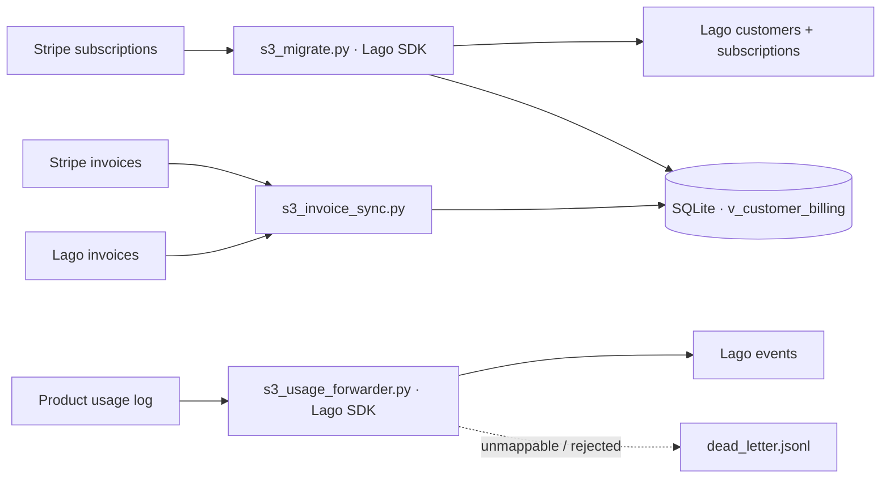

# Section 3: Stripe → Lago migration (customers, subscriptions, usage, invoices)

> **Bottom line**
> **Verified** against Stripe test mode and self-hosted Lago v1.57.0 (PostgreSQL event store): **100 of 100** subscriptions migrated with 0 failures, re-runs are no-ops, the usage flow is replay-safe, and invoices from both systems sit in one SQLite database with a reconciliation view.
> **Proposed, not yet proven:** the 10,000-subscription rollout and the period-end cutover; both need a load test and a pilot cohort.
> Key design choice: **Stripe ids become Lago external ids**, so there's no mapping table and the usage stream switches destination without a lookup.



## 1. Customers and subscriptions ([s3_migrate.py](../src/lago_case/s3_migrate.py))

| Stripe | Lago |
|---|---|
| `customer.id`, name, email, currency | `customer.external_id`, name, email, currency (Lago upserts by `external_id`) |
| `subscription.id` | `subscription.external_id` on plan `saasco_standard` |
| Seats `quantity` | N `seats` add-events on a recurring metric, with deterministic `transaction_id`s so a retry never adds a seat |
| `current_period_end` | `subscription_at` + anniversary billing (customers keep their billing date) |

```text
$ uv run python -m lago_case.s3_migrate --start now
Migrated 100, failed 0 in 22.2s (4.5 subscriptions/s)
Reconciliation: Stripe 100 | Lago 100 | missing 0
$ (re-run)  Already migrated (checkpoint): 100. To migrate now: 0
```

**Safeguards designed for 10,000 (scale untested):** a SQLite checkpoint per subscription plus a Lago existence check (resumable after a crash), bounded concurrency with retries on 429/5xx, `--dry-run`, and a reconciliation report at the end of every run. A linear extrapolation gives ~37 minutes for 10,000, but that's an **estimate**: rate limits, data variety and recovery can behave differently at scale. Plan: load test on synthetic Stripe-shaped data → pilot cohort (~500) → batches with a reconciliation report after each.

## 2. The usage flow ([s3_usage_forwarder.py](../src/lago_case/s3_usage_forwarder.py))

`stripe.billing.MeterEvent.create(...)` is replaced by `lago.events.batch_create(...)` through the Lago Python SDK.

```text
Forwarded 900 new events, skipped 0 already ingested, in 2.1s; dead-lettered 1 (gpu_hours: no Lago metric)
(replay)  Forwarded 0 new events, skipped 900 already ingested, in 1.9s   -> usage unchanged
```

- **Replay-safe:** the product's record id becomes `transaction_id`. ✅ On the PostgreSQL event store, a duplicate gets a per-record `422 value_already_exist`, which the forwarder counts as "already ingested." ⚠️ The ClickHouse store (used for Kafka) deduplicates differently, so re-verify, and keep timestamps stable across retries.
- **Atomic batches, no data loss:** ✅ one invalid event rejects the whole batch, so the forwarder reads the per-record errors, dead-letters the invalid records with Lago's reason, and resends the valid ones.
- **Accepted ≠ billed:** a success response means Lago stored the event, not that it will bill it. ✅ Events stamped before a subscription starts are stored but not billed; 📘 so are events for unknown subscriptions or metric codes. Mappings are validated before sending; production should also reconcile units sent against `current_usage`.

## 3. Invoices from both systems ([s3_invoice_sync.py](../src/lago_case/s3_invoice_sync.py), [db.py](../src/lago_case/db.py))

✅ 100 Stripe and 8 Lago invoices are stored in `invoices` and `invoice_lines` (SKU, quantity, amount, service period; all Lago lines carry one), upserted on `(source, id)`, so re-syncing never duplicates rows. `v_customer_billing` compares both systems per customer through the shared id.

> **What the reconciliation view caught:** for one customer, Stripe had already invoiced 20 seats **in advance** for 18 Nov–18 Dec ($400), and Lago billed them again, because the demo started Lago "now." That's exactly the double-billing a real cutover must avoid.

## 4. Cutover for the real 10,000 (proposed design, to validate with a pilot)
1. **Rolling, per subscription, at each Stripe period end:** `subscription_at` = Stripe `current_period_end`, so no period is billed twice.
2. **Two-phase:** set Stripe `cancel_at_period_end` only after the Lago subscription is verified.
3. **Send usage to both systems during the overlap;** Lago counts only events inside its own period.
4. **Parallel-run check:** compare per-customer totals in `v_customer_billing` for one cycle before switching Stripe off.

**Next to harden:** a real 10,000 run (p95 latency, error budget), syncing seat changes during the overlap, and a Lago webhook receiver for real-time invoice updates. Taxes, coupons and multi-currency customers are out of scope for this single-plan company.
